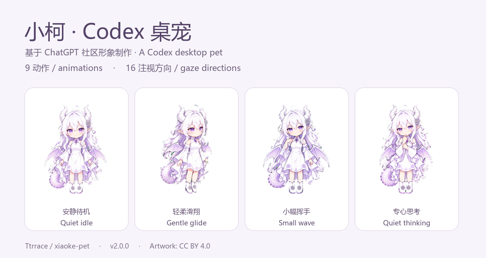

# 小柯 · Codex 桌宠

**基于 ChatGPT 社区形象制作的 Codex 桌宠。**

小柯（Xiaoke）陪你写代码、调试和等待灵感。简洁 Q 版动漫造型，轻柔滑翔、安静思考，站立与移动保持统一的角色比例。

**中文** · [English](README.en.md)



[下载完整素材包](https://github.com/Ttrrace/xiaoke-pet/raw/refs/heads/main/downloads/xiaoke-pet-v2.zip) · [透明图集](assets/spritesheet-extended.png) · [全部动作 GIF](previews/all-states.gif) · [MP4 预览](previews/all-states.mp4)

## 当前客户端的实际支持

部分动作暂时无法在当前版本的 Codex 中触发，下方预览展示了全部动作。

## 动作素材预览

以下 GIF 按素材条带连续循环，便于查看画面；它们不是客户端录屏，也没有模拟客户端的完整播放与触发逻辑。

| 待机 → 向右滑翔 → 待机 | 待机 → 轻轻上浮 → 待机 |
| :---: | :---: |
|  |  |

| 打招呼 | 等你回应 | 专心思考 |
| :---: | :---: | :---: |
|  |  |  |

| 小小失落 | 检查结果 | 十六方向素材 |
| :---: | :---: | :---: |
|  |  |  |

## 包含什么

- 一张透明 RGBA PNG 动画图集：**1536 × 2288**，单元 **192 × 208**。
- **九组动作素材、十六个注视方向，共 73 帧**；未使用的单元保持透明。实际触发取决于客户端。
- 各动作 GIF、状态切换 GIF、完整 MP4、逐帧总览与方向对照图。
- 中英说明、图集格式说明，以及可独立运行的预览和验证工具。

这是一套用于 Codex 桌宠的平面动画素材，采用 Pets v2 图集格式，不是 Live2D 或 3D 模型。形象来自 ChatGPT 社区创作，并非 OpenAI 官方角色。

## 怎么使用

### 在 Codex 中使用

1. 下载 [spritesheet-extended.png](assets/spritesheet-extended.png)，保留透明背景与完整尺寸。
2. 在已启用 Pets 插件、支持自定义宠物的 Codex 环境中，把 PNG 交给助手，例如：

   > 请验证这张 v2 宠物图集，创建一个名叫「小柯」的自定义宠物，并选中它。

3. 由 Pets 工具完成验证、上传、创建和选中。已经有同名宠物时，请明确说明是更新哪一个。

客户端需要支持相应功能；这个仓库不会自动安装或启用插件。**帧率、鼠标触发事件和循环次数由客户端控制**，替换图集不会改变这些设置。GIF 展示的是素材条带的预览节奏；当前客户端还会使用慢速待机与三次播放后回待机等逻辑，详见 [触发说明](docs/runtime.md)。

### 在其他项目中使用

按照 [图集格式说明](docs/format.md) 裁出帧即可。状态名 `running` 对应专心思考，`running-left` 和 `running-right` 才是左右移动。移动动画表现为轻柔滑翔。

```bash
python -m pip install -r requirements.txt
python tools/verify_assets.py
python tools/preview.py --output-dir build/previews
```

工具只依赖 Pillow。预览脚本从原图集裁帧，不重绘角色；运行结果保存在被 Git 忽略的 `build/` 中。

## 素材目录

```text
assets/                     透明图集与帧布局元数据
previews/                   封面、GIF、MP4 和对照图
previews/states/            九种单项动作
downloads/                 可直接下载的完整素材包
docs/format.md             中英图集格式说明
docs/runtime.md            当前客户端触发条件与验证范围
tools/                     预览与文件完整性检查
LICENSES/                  完整许可文本
```

[查看逐帧总览](previews/contact-sheet.png) · [查看十六方向对照](previews/direction-sheet.png)

## 版本与验证

本次公开的是**第二版素材**，版本号 `2.0.0`。重点调整了头身比例、移动姿态、手部结构与小幅循环动作。

- 已通过 v2 图集结构检查与 Pets 服务端文件校验。
- 已进行逐帧外观检查，以及三份独立方向盲测。
- 上传后重新下载核对，解码后的 RGBA 像素与本仓库图集一致。
- 靠近垂直方向时，视线差异刻意保持细微；跨动作仍有绘制差异，它不是骨骼驱动模型。

上述记录验证的是文件、画面和上传保存结果，**没有验证所有动作在原生浮动桌宠中的触发情况**。方向盲测判断的是绘制方向是否可辨，不代表已实现鼠标跟随。可用 `tools/verify_assets.py` 核对本地文件与 [manifest.json](manifest.json) 中的摘要。

## 开放使用与署名

**美术素材与文档：CC BY 4.0；工具代码：MIT。** 可在相应许可条件下分享、修改和复用。建议署名：

> 小柯 / Xiaoke by Ttrrace — https://github.com/Ttrrace/xiaoke-pet — CC BY 4.0。若有修改，请注明。

角色参考、生成方式与许可范围见 [CREDITS.md](CREDITS.md) 和 [LICENSE.md](LICENSE.md)。欢迎在 [Issues](https://github.com/Ttrrace/xiaoke-pet/issues) 反馈动作衔接、透明边缘或比例问题；提供状态名和帧编号会更容易定位。
