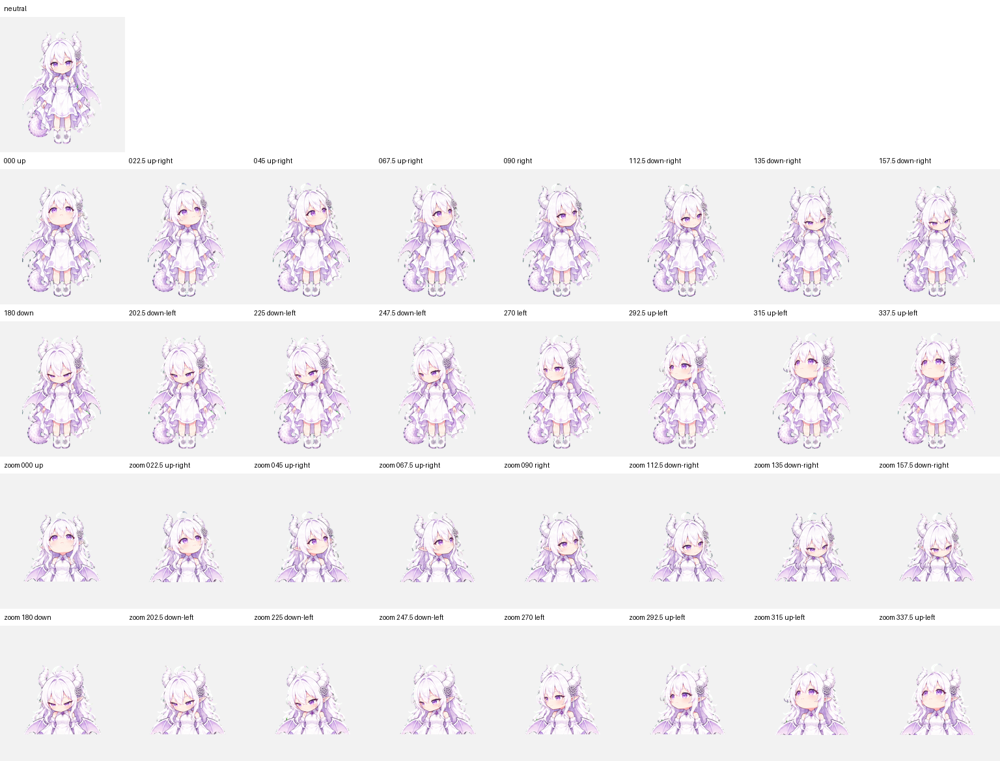

# 图集格式 / Sprite-sheet layout

[中文首页](../README.md) · [English README](../README.en.md)

版本 / Version: `2.0.0` artwork, `v2` sprite layout.

| 属性 / Property | 值 / Value |
| --- | --- |
| 文件 / File | `assets/spritesheet-extended.png` |
| 编码 / Encoding | PNG, RGBA, transparent background |
| 尺寸 / Dimensions | 1536 × 2288 px |
| 单元 / Cell | 192 × 208 px |
| 网格 / Grid | 8 columns × 11 rows |
| 有效帧 / Occupied cells | 73 |
| 透明空位 / Unused cells | 15 |
| 原点 / Origin | Top-left; row and column indices start at 0 |

## 动作行 / Animation rows

每行从第 0 列开始；剩余单元完全透明。 / Frames start in column 0 of each row; remaining cells are fully transparent.

| 行 / Row | 状态键 / Key | 帧数 / Frames | 动作 / Artwork |
| --- | --- | ---: | --- |
| 0 | `idle` | 6 | 安静待机 / Quiet idle |
| 1 | `running-right` | 8 | 向右滑翔 / Glide right |
| 2 | `running-left` | 8 | 向左滑翔 / Glide left |
| 3 | `waving` | 4 | 小幅挥手 / Small wave |
| 4 | `jumping` | 5 | 轻微上浮后落回 / Gentle float and return |
| 5 | `failed` | 8 | 失落与恢复 / Disappointment and recovery |
| 6 | `waiting` | 6 | 等待回应 / Waiting for input |
| 7 | `running` | 6 | 触碰下巴思考 / Chin-touch thinking |
| 8 | `review` | 6 | 垂眸检查 / Reviewing |
| 9 | look, first half | 8 | 000°–157.5° |
| 10 | look, second half | 8 | 180°–337.5° |

裁切框采用左闭右开坐标： / Crop boxes use an inclusive left/top and exclusive right/bottom:

```python
left = column * 192
top = row * 208
frame = image.crop((left, top, left + 192, top + 208))
```

## 注视方向 / Gaze directions

**0° 朝上，顺时针递增；左、右均以观看者屏幕为准。** / **0° points up and angles increase clockwise. Left and right refer to the viewer's screen.**

| 行 / Row | 列 0 / Col 0 | 1 | 2 | 3 | 4 | 5 | 6 | 7 |
| --- | --- | --- | --- | --- | --- | --- | --- | --- |
| 9 | 000 up | 022.5 up-right | 045 up-right | 067.5 up-right | 090 right | 112.5 down-right | 135 down-right | 157.5 down-right |
| 10 | 180 down | 202.5 down-left | 225 down-left | 247.5 down-left | 270 left | 292.5 up-left | 315 up-left | 337.5 up-left |

身体保持正面，主要通过眼睛和轻微的头部角度表达方向。没有额外的中立单元；中立表情使用普通待机帧。 / The torso stays frontal; eyes and small head-angle changes convey direction. There is no extra neutral cell: use a normal idle frame for neutral.



## 播放与检查 / Playback and checks

`assets/layout.json` 记录了各行帧数和预览用毫秒时长。这些时长用于复现导出的 GIF，不是对客户端播放速度的设置。 / `assets/layout.json` records frame counts and preview durations in milliseconds. These reproduce the exported GIF cadence; they do not configure client playback.

预览工具连续循环素材条带，不模拟原生浮窗的三遍播放后回待机、慢速待机或状态优先级。十六方向单元是素材格式的一部分，不会自行添加鼠标监听。实际支持情况见 [客户端触发说明](runtime.md)。 / The preview tool loops artwork strips; it does not simulate the floating client's three-repeat-then-idle sequence, slow idle, or state priorities. Sixteen gaze cells do not themselves add pointer tracking. See the [runtime notes](runtime.md).

图集保持原始分辨率和透明通道，不要额外加边框、压扁、整体重排或将空单元填白。 / Preserve the original resolution and alpha channel. Do not add borders, distort or rearrange the sheet, or fill unused cells with white.

```bash
python tools/verify_assets.py
python tools/preview.py --output-dir build/previews
```

`verify_assets.py` 检查文件摘要、图集尺寸、有效单元和透明空位；它不代替 Pets 服务的视觉审核，也不判断动作质量。 / `verify_assets.py` checks file hashes, sheet dimensions, occupied cells, and unused transparency. It does not replace Pets service moderation or assess animation quality.
